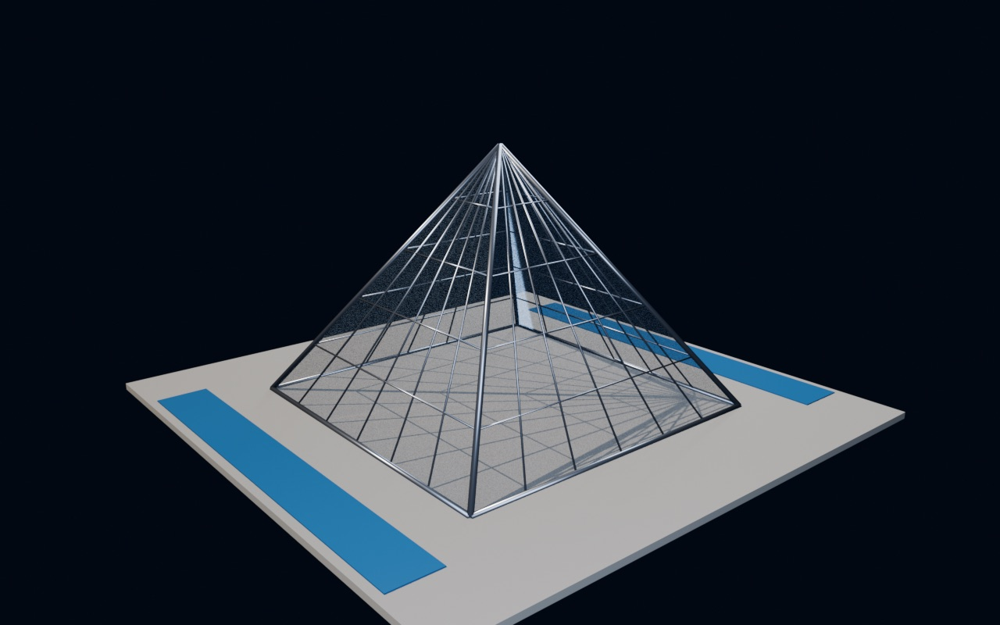

# Vektoren im Raum – Werkzeug für die analytische Geometrie

Interaktives 3D-Werkzeug (Blender → Three.js) für die Vektorgeometrie der Oberstufe (NRW, Q-Phase): Punkte, Vektoren, Geraden und Ebenen eingeben, im Schrägbild drehen und mit vollständigem Rechenweg untersuchen. Dazu drei geführte Aufgaben mit Blender-Modellen. Optimiert für Desktop, Tablet und Handy. LMG TECH.



## Online

https://simon23-12.github.io/BLENDERmath/

Jeder Push auf `main` veröffentlicht den Ordner `web/` automatisch über GitHub Pages – ohne Build-Schritt, ohne npm.

## Lokal ansehen

```bash
node serve.mjs
```

Dann http://127.0.0.1:5173 öffnen (kein `npm install` nötig; Three.js und KaTeX kommen von jsDelivr).

## Werkstatt: Eingabe

| Eingabe | Objekt |
| --- | --- |
| `A(1|2|3)` · `A(1,5|2|0)` · `A = (1,2,3)` | Punkt |
| `u = (2|−1|0)` · `u = AB` · `u = B − A` | Vektor (bei `AB` ab A gezeichnet) |
| `g: x = (1|0|2) + t·(1|1|0)` · `g: x = A + t·AB` | Gerade (Parameterform) |
| `g = Gerade(A, B)` | Gerade durch zwei Punkte |
| `E: 2x1 − x2 + 3x3 = 6` · `E: x + y + z = 1` | Ebene (Koordinatenform) |
| `E: x = A + r·u + s·v` | Ebene (Parameterform) |
| `E: (x − (1|0|0))·(2|1|0) = 0` | Ebene (Normalenform) |
| `E = Ebene(A, B, C)` · `M = Mittelpunkt(A, B)` | Konstruktionen |

Großbuchstabe = Punkt/Ebene, Kleinbuchstabe = Vektor/Gerade. Objekte werden im Browser gespeichert.

## Was berechnet wird (mit Rechenweg)

- **Punkt:** Ortsvektor, Abstand zum Ursprung, Lage (Oktant, Achse, Koordinatenebene), Koordinatenweg im Schrägbild.
- **Vektor:** Betrag, Einheitsvektor, Winkel zu den Achsen.
- **Gerade:** Parameterform, Spurpunkte, besondere Lage; ein Regler bewegt den Punkt X(t) über die Gerade.
- **Ebene:** alle Formen ineinander umgerechnet (Normalenvektor per Kreuzprodukt), Hessesche Normalform, Spurpunkte, Spurgeraden, Achsenabschnittsform, Abstand zum Ursprung; Regler für X(r, s).
- **Lagebeziehungen** (zweites Objekt mit Umschalt-Klick oder „Lage zu“ wählen):
  Punkt–Punkt (Abstand, Mittelpunkt) · Punkt–Gerade (Punktprobe, Lotfußpunkt, Abstand) · Punkt–Ebene (Punktprobe, Hesse-Abstand, Lotfußpunkt, Spiegelpunkt) · Gerade–Gerade (identisch, parallel, schneidend mit Schnittwinkel, windschief mit Abstand und gemeinsamem Lot) · Gerade–Ebene (Durchstoßpunkt, Schnittwinkel, Abstand) · Ebene–Ebene (Schnittgerade, Schnittwinkel, Abstand) · Vektor–Vektor (Skalarprodukt, Winkel, Kreuzprodukt, Flächen).
- Ergebnisse werden als Brüche und Wurzeln angezeigt (z. B. `3√2 ≈ 4,24`), gesetzt mit KaTeX.

## Aufgaben

1. **Die Glaspyramide** – Kantenlänge, Seitenfläche als Ebene, Neigungswinkel, Volumen, Abstand zur Seitenfläche.
2. **Zwei Flugbahnen** – windschiefe Geraden: Abstand der Bahnen vs. Abstand der Flugzeuge zur gleichen Zeit (die Flugzeuge fliegen mit).
3. **Schatten am Hang** – Sonnenstrahl durch die Mastspitze, Durchstoßpunkte mit Wiese und Hang, geknickter Schatten.

## Aufbau

- `blender/build_math.py` – erzeugt die Bausteine (Pfeilschaft, Pfeilspitze, Punkt) und die Szenen-Modelle (Glaspyramide auf einem Platz, zwei Verkehrsflugzeuge, Gittermast mit Hang und Sonne) prozedural im offenen Blender und schreibt `web/models/math.glb`. Mathematische Koordinaten (x₁|x₂|x₃) liegen in Blender bei (x₂, −x₁, x₃), damit im Browser x₁ nach vorne, x₂ nach rechts und x₃ nach oben zeigt – wie im Schulbuch-Schrägbild.
- `web/src/geo.js` – Vektorrechnung, Parser (lineare Ausdrücke in Parametern, Brüche, Dezimalkomma) und alle Rechenwege; ohne Abhängigkeiten, in Node testbar.
- `web/src/main.js` – 3D-Darstellung, Auswahl, Infofeld, Aufgabenmodus; `web/src/scenarios.js` – die Aufgaben.
